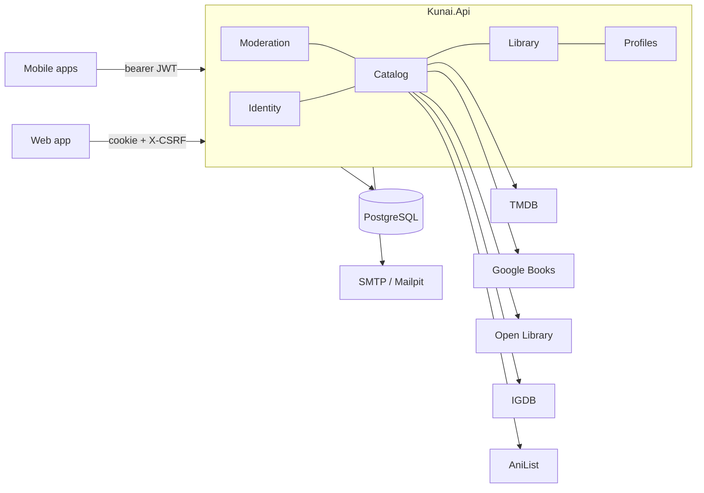

# Kunai

> Read. Watch. Play. Hit the mark.

Kunai is a personal media tracker: books, movies, TV series, games, anime and manga on one shelf, with a public profile, yearly goals ("missions") and a ninja belt that grows as you finish things.

This repository contains the **HTTP API** that the web app and the native mobile apps use.

## Features

- **Accounts:** registration with email confirmation, sign-in with email or username, password reset and change, account deletion, breached-password check, lockout.
- **Sessions:** httpOnly cookie for the web (with CSRF protection), ES256 access tokens and rotating single-use refresh tokens for mobile, one revocable session per device.
- **Catalog:** search TMDB (movies, series), Google Books with Open Library as fallback (books), IGDB (games) and AniList (anime, manga); import results on demand; add missing books by hand, reviewed by moderators.
- **Shelf:** statuses per type (want to read, reading, read, on hold, dropped...), rating, dates, progress, review, favorites; ETags against lost updates; filters, sorting and cursor paging.
- **Profiles:** public or private profile, counts, this year's completions, favorites, yearly stats, missions, seven belts from white to black, twelve built-in ninja avatars painted with the belt color.
- **Localization:** status labels and emails in Turkish and English; dates in the user's time zone.

## Tech stack

| Area | Choice |
|---|---|
| Runtime | .NET 10 (LTS), C# 14 |
| API | ASP.NET Core Minimal APIs, vertical slices, built-in validation, RFC 9457 problem details |
| Data | PostgreSQL 18, EF Core 10 (Npgsql), HybridCache |
| Identity | ASP.NET Core Identity, cookie + JWT (ES256) with server-side sessions |
| Docs | OpenAPI 3.1 (`/openapi/v1.json`), Scalar (`/docs`) |
| Resilience | Microsoft.Extensions.Http.Resilience per provider, client-side rate limits |
| Local orchestration | Aspire 17: Postgres, pgAdmin, Mailpit, the API |
| Observability | OpenTelemetry logs, traces and metrics; health checks |
| Tests | xUnit v3 on Microsoft Testing Platform, AwesomeAssertions, Testcontainers (PostgreSQL), WireMock.Net, ArchUnitNET |
| Quality gates | Nullable, warnings as errors, .NET analyzers + Meziantou, central package management, NuGet audit, `dotnet format` |
| CI | GitHub Actions, Dependabot |

## Architecture



The decisions behind it are recorded in [docs/adr](docs/adr/README.md).

## Getting started

Prerequisites: .NET SDK 10.0.404 or newer (pinned in `global.json`) and Docker running.

```bash
dotnet run --project src/Kunai.AppHost
```

This starts PostgreSQL, pgAdmin, Mailpit and the API, applies migrations and prints a link to the Aspire dashboard. From the dashboard, open the API's `/docs` for the interactive reference and Mailpit to read the confirmation emails.

### Provider keys (optional locally)

Search works for books (Google Books, Open Library) and anime/manga (AniList) without keys. Movies, series and games need keys; store them as user secrets of the API project:

```bash
dotnet user-secrets set "Providers:Tmdb:AccessToken" "<TMDB API read access token>" --project src/Kunai.Api
```

```bash
dotnet user-secrets set "Providers:Igdb:ClientId" "<Twitch client id>" --project src/Kunai.Api
```

```bash
dotnet user-secrets set "Providers:Igdb:ClientSecret" "<Twitch client secret>" --project src/Kunai.Api
```

To make your own account an admin and moderator, add its email under `Admin:Emails` (user secrets or environment) and restart.

### Tests

```bash
dotnet test
```

Integration tests start their own PostgreSQL container and stub every provider with WireMock, so Docker must be running; no keys are needed.

## Repository layout

```
src/
  Kunai.AppHost/          Aspire orchestration for local development
  Kunai.ServiceDefaults/  OpenTelemetry, health checks, service discovery
  Kunai.Api/
    Common/               Feature-agnostic plumbing: results, problem details, rate limits, email
    Persistence/          AppDbContext and migrations
    Features/
      Identity/           Registration, sign-in, sessions, passwords, account deletion
      Catalog/            Item types, search, import, providers, manual books
      Library/            The shelf
      Profiles/           /me, public profiles, stats, belts, goals, avatars
      Moderation/         Review queue for manual books
tests/
  Kunai.Api.UnitTests/          Domain rules
  Kunai.Api.IntegrationTests/   HTTP tests against a real database
  Kunai.ArchitectureTests/      Dependency rules
docs/
  adr/                    Architecture decision records
  errors.md               Error code catalogue
  client-integration.md   Guide for the web and mobile clients
```

## Documentation

- [Client integration guide](docs/client-integration.md): sign-in flows, adding to a shelf, ETags, paging, retries.
- [Error codes](docs/errors.md)
- [Architecture decisions](docs/adr/README.md)
- [Roadmap](docs/ROADMAP.md)
- [`Kunai.Api.http`](src/Kunai.Api/Kunai.Api.http): sample requests for VS Code, Rider and Visual Studio.

## Attribution

Movie and series data: this product uses the TMDB API but is not endorsed or certified by TMDB. Book data from Google Books and Open Library, game data from IGDB.com, anime and manga data from AniList.
